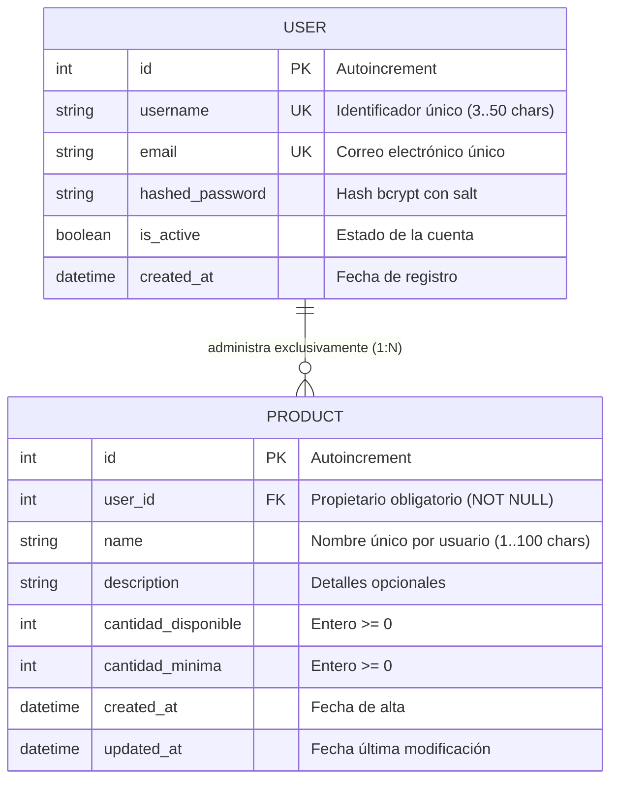
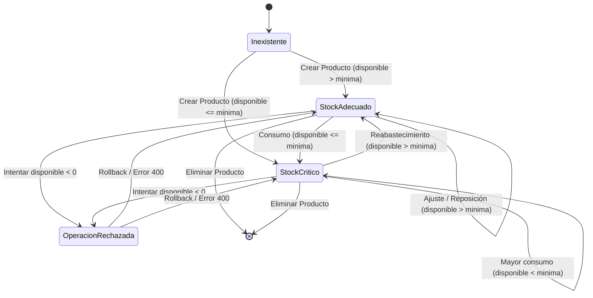

# Data Model & Domain Design: Inventario Personal

**Feature**: `specs/001-personal-inventory`  
**Date**: 2026-09-25  
**Status**: Completed (Actualizado con Regla de No Negatividad y Detección de Stock Bajo)  

---

## 1. Diagrama Entidad-Relación (ER)

---

## 2. Entidades de Dominio y Persistencia

### 2.1 Entidad `User`
Representa al usuario registrado y autenticado del sistema, titular de un espacio privado de inventario.

- **Campos**:
  - `id: int`: Identificador único primario (autoincremental).
  - `username: str`: Nombre de usuario alfanumérico único (longitud: 3 a 50 caracteres).
  - `email: str`: Dirección de correo electrónico única y normalizada.
  - `hashed_password: str`: Hash seguro generado con algoritmo bcrypt (mínimo 60 caracteres).
  - `is_active: bool`: Bandera booleana de estado (por defecto `True`).
  - `created_at: datetime`: Marca temporal UTC de registro.
- **Relaciones**:
  - Colección de `products`: Relación 1 a N con `Product`, con eliminación en cascada si el usuario es dado de baja.
- **Invariantes y Restricciones**:
  - `username` y `email` son únicos a nivel de tabla.
  - La contraseña en texto plano nunca se almacena ni se expone.

### 2.2 Entidad `Product`
Representa un artículo o bien administrado dentro del inventario del usuario.

- **Campos**:
  - `id: int`: Identificador único primario (autoincremental).
  - `user_id: int`: Llave foránea hacia `User.id` (estrictamente no nulo, indexado).
  - `name: str`: Nombre del producto (longitud: 1 a 100 caracteres, texto no vacío tras stripping).
  - `description: Optional[str]`: Descripción detallada del artículo (opcional, hasta 500 caracteres).
  - `cantidad_disponible: int`: Número entero mayor o igual a 0.
  - `cantidad_minima: int`: Número entero mayor o igual a 0.
  - `created_at: datetime`: Marca temporal UTC de creación.
  - `updated_at: datetime`: Marca temporal UTC de última modificación.
- **Propiedades Calculadas (Lógica de Dominio)**:
  - `is_low_stock -> bool`: Retorna `True` si `cantidad_disponible <= cantidad_minima`, indicando inventario crítico o necesidad de abastecimiento (incluye tanto `disponible == minima` como `disponible < minima`).
- **Restricciones de Integridad y Reglas de Dominio**:
  - **Restricciones de No Negatividad en BD**:
    - `CheckConstraint('cantidad_disponible >= 0', name='ck_cantidad_disponible_non_negative')`
    - `CheckConstraint('cantidad_minima >= 0', name='ck_cantidad_minima_non_negative')`
  - **Permisión de Déficit de Stock**: Se permite explícitamente `cantidad_disponible < cantidad_minima` para reflejar el consumo por debajo del umbral mínimo de seguridad.
  - **Unicidad de Nombre por Usuario**: `UniqueConstraint('user_id', 'name', name='uq_user_product_name')` para evitar artículos duplicados dentro del catálogo de un mismo usuario. Dos usuarios distintos pueden utilizar el mismo nombre.
  - **Respuesta ante Nombres Duplicados**: La capa `services` captura colisiones de nombre (previa consulta o captura controlada de integridad) y emite `DuplicateEntityError`, traduciéndose en HTTP 400 Bad Request (`{"detail": "Ya existe un producto con el nombre '[nombre]' en tu inventario"}`) sin exponer errores internos de base de datos ni provocar caídas HTTP 500.

---

## 3. Esquemas de Datos y DTOs (Pydantic / schemas)

### 3.1 Esquemas de Autenticación (`schemas/auth.py`)
- `UserRegisterRequest`:
  - `username: str` (min_length=3, max_length=50)
  - `email: EmailStr`
  - `password: str` (min_length=8)
- `UserLoginRequest` / `OAuth2PasswordRequestForm`:
  - `username: str`
  - `password: str`
- `TokenResponse`:
  - `access_token: str`
  - `token_type: str = "bearer"`
  - `expires_in: int`
- `UserResponse`:
  - `id: int`
  - `username: str`
  - `email: str`
  - `created_at: datetime`

### 3.2 Esquemas de Inventario (`schemas/product.py`)
- `ProductCreateRequest`:
  - `name: str` (min_length=1, max_length=100)
  - `description: Optional[str] = None`
  - `cantidad_disponible: int` (ge=0)
  - `cantidad_minima: int` (ge=0)
- `ProductUpdateRequest`:
  - `name: Optional[str] = None` (min_length=1, max_length=100)
  - `description: Optional[str] = None`
  - `cantidad_disponible: Optional[int] = None` (ge=0)
  - `cantidad_minima: Optional[int] = None` (ge=0)
  - *Revalidación en Service*: Si se actualizan cantidades, ambas deben validarse como enteros `>= 0`.
- `ProductAdjustStockRequest`:
  - `nueva_cantidad_disponible: int` (ge=0)
  - `motivo: Optional[str] = None`
- `ProductResponse`:
  - `id: int`
  - `user_id: int`
  - `name: str`
  - `description: Optional[str]`
  - `cantidad_disponible: int`
  - `cantidad_minima: int`
  - `is_low_stock: bool`
  - `created_at: datetime`
  - `updated_at: datetime`
- `ProductListResponse`:
  - `items: List[ProductResponse]`
  - `total: int`
  - `total_low_stock: int`

---

## 4. Máquina de Estados y Transiciones de Existencias

