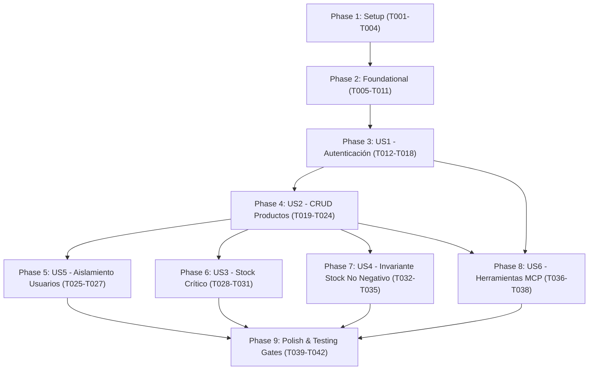

# Tasks: Inventario Personal

**Input**: Design documents from `specs/001-personal-inventory/` (`spec.md`, `plan.md`, `data-model.md`, `research.md`, `contracts/`, `quickstart.md`)  
**Prerequisites**: Constitución del proyecto (`.specify/memory/constitution.md` v2.0.0)  

---

## Phase 1: Setup (Shared Infrastructure)

**Purpose**: Inicialización del proyecto, dependencias y estructura modular por capas.

- [X] T001 Crear estructura de directorios del proyecto y archivos `__init__.py` en `src/` (`routers`, `mcp`, `services`, `repositories`, `models`, `schemas`, `utils`) y `tests/` (`fakes`, `unit`, `integration`)
- [X] T002 [P] Configurar dependencias del proyecto en `requirements.txt` (`fastapi>=0.110.0`, `uvicorn>=0.28.0`, `pydantic[email]>=2.6.0`, `pydantic-settings>=2.2.0`, `sqlalchemy>=2.0.28`, `pyjwt>=2.8.0`, `passlib[bcrypt]>=1.7.4`, `pytest>=8.0.0`, `pytest-cov>=4.1.0`, `httpx>=0.27.0`, `fastmcp>=0.1.0`)
- [X] T003 [P] Configurar variables de entorno y exclusión de secretos en `.env.example` y `.gitignore` (garantizando que `.env` esté estrictamente ignorado por Git)
- [X] T004 [P] Configurar gestión centralizada de configuración con Pydantic Settings (`DATABASE_URL`, `SECRET_KEY`, `ALGORITHM`, `ACCESS_TOKEN_EXPIRE_MINUTES`) en `src/config.py`

---

## Phase 2: Foundational (Blocking Prerequisites)

**Purpose**: Infraestructura transversal básica, utilidades de seguridad, excepciones de dominio, interfaces abstractas de repositorios y repositorios falsos para pruebas sin `unittest.mock`.

**⚠️ CRITICAL**: Ninguna historia de usuario puede comenzar hasta que esta fase esté completada.

- [X] T005 [P] Implementar utilidades criptográficas de contraseñas (`hash_password`, `verify_password` con bcrypt) y generación/decodificación de JWT (`create_access_token`, `decode_access_token`) en `src/utils/security.py`
- [X] T006 [P] Configurar motor SQLAlchemy, `sessionmaker` y base declarativa `Base` para SQLite (`sqlite:///./inventario.db` con soporte de `foreign_keys=ON`) en `src/models/base.py`
- [X] T007 [P] Definir excepciones de dominio del sistema (`EntityNotFoundError`, `InvariantViolationError`, `AuthenticationError`, `AccessDeniedError`, `DuplicateEntityError`) en `src/services/exceptions.py`
- [X] T008 [P] Definir interfaces abstractas y protocolos de acceso a datos (`UserRepositoryProtocol`, `ProductRepositoryProtocol`) en `src/repositories/base.py`
- [X] T009 [P] Implementar repositorio falso de usuarios en memoria `FakeUserRepository` (cumpliendo `UserRepositoryProtocol` con `dict[int, User]`) en `tests/fakes/fake_user_repository.py`
- [X] T010 [P] Implementar repositorio falso de productos en memoria `FakeProductRepository` (cumpliendo `ProductRepositoryProtocol` con `dict[int, Product]`) en `tests/fakes/fake_product_repository.py`
- [X] T011 Configurar fixtures globales de pytest y generadores de datos de prueba (fakes instanciados y sesión de prueba) en `tests/conftest.py`

**Checkpoint**: Base lista e interfaces desacopladas. Las historias de usuario pueden implementarse con pruebas unitarias deterministas.

---

## Phase 3: User Story 1 - Registro e Inicio de Sesión de Usuario (Priority: P1) 🎯 MVP

**Goal**: Permitir que los usuarios registren una cuenta personal e inicien sesión de forma segura para obtener un token JWT que identifique su espacio privado.

**Independent Test**: Registrar un usuario con credenciales válidas, iniciar sesión con contraseña correcta, verificar emisión de token JWT y rechazar intentos con credenciales erróneas o usuarios duplicados.

### Tests for User Story 1
- [X] T012 [P] [US1] Escribir pruebas unitarias de `AuthService` usando `FakeUserRepository` (sin `unittest.mock`) validando registro, login y rechazo de credenciales inválidas en `tests/unit/test_auth_service.py`

### Implementation for User Story 1
- [X] T013 [P] [US1] Definir modelo ORM `User` con campos `id` (PK autoincrement), `username` ("único, 3 a 50 caracteres"), `email` ("único, formato email"), `hashed_password` ("hash bcrypt no nulo") y `created_at` en `src/models/user.py`
- [X] T014 [P] [US1] Definir esquemas Pydantic `UserRegisterRequest` (con `password` de mínimo 8 caracteres), `UserLoginRequest`, `TokenResponse` y `UserResponse` en `src/schemas/auth.py`
- [X] T015 [US1] Implementar repositorio SQLAlchemy `UserRepository` para búsqueda y persistencia de usuarios en base de datos en `src/repositories/user_repository.py`
- [X] T016 [US1] Implementar servicio de autenticación `AuthService` con repositorio inyectado (`register_user`, `authenticate_user`) en `src/services/auth_service.py`
- [X] T017 [US1] Implementar inyección de dependencias para autenticación y extracción del usuario actual (`get_current_user`) desde la cabecera `Authorization: Bearer <token>` en `src/routers/dependencies.py`
- [X] T018 [US1] Implementar endpoints REST `/api/v1/auth/register`, `/api/v1/auth/login` y `/api/v1/auth/me` en `src/routers/auth_router.py`

**Checkpoint**: Autenticación y gestión de sesiones operativas.

---

## Phase 4: User Story 2 - Gestión Básica de Productos del Inventario (CRUD) (Priority: P1)

**Goal**: Permitir al usuario autenticado crear, listar, consultar, actualizar y eliminar productos de su catálogo personal con nombre, descripción opcional y cantidades enteras no negativas, revalidando cantidades al editar y controlando duplicados amigablemente.

**Independent Test**: Crear un producto con cantidades válidas, verificar que aparece en el listado del usuario, editar nombre o descripción revalidando cantidades, verificar rechazo ante duplicidad de nombre del mismo usuario (HTTP 400) y eliminarlo verificando que deja de existir.

### Tests for User Story 2
- [X] T019 [P] [US2] Escribir pruebas unitarias para operaciones CRUD en `ProductService` utilizando `FakeProductRepository` (sin `unittest.mock`) validando creación, edición con revalidación de cantidades y rechazo de nombres duplicados en `tests/unit/test_product_service.py`

### Implementation for User Story 2
- [X] T020 [P] [US2] Definir modelo ORM `Product` con `id` (PK), `user_id` (FK NOT NULL), `name` ("1 a 100 caracteres"), `description` ("texto opcional"), `cantidad_disponible` ("entero >= 0"), `cantidad_minima` ("entero >= 0"), `CheckConstraint('cantidad_disponible >= 0')`, `CheckConstraint('cantidad_minima >= 0')` y `UniqueConstraint('user_id', 'name')` en `src/models/product.py`
- [X] T021 [P] [US2] Definir esquemas Pydantic `ProductCreateRequest`, `ProductUpdateRequest`, `ProductResponse` y `ProductListResponse` validando enteros no negativos (`ge=0`) en `src/schemas/product.py`
- [X] T022 [US2] Implementar repositorio SQLAlchemy `ProductRepository` cumpliendo `ProductRepositoryProtocol` en `src/repositories/product_repository.py`
- [X] T023 [US2] Implementar métodos CRUD (`create_product`, `get_product`, `list_products`, `update_product`, `delete_product`) en `ProductService` con repositorio inyectado, validando cantidades no negativas (`>= 0`), revalidando ambas cantidades en `update_product` y lanzando `DuplicateEntityError` ante colisiones de nombre en `src/services/product_service.py`
- [X] T024 [US2] Implementar endpoints REST `/api/v1/products` (POST, GET catálogo con paginación, GET `{id}`, PUT `{id}`, DELETE `{id}`) en `src/routers/product_router.py` manejando `DuplicateEntityError` con HTTP 400 Bad Request sin exponer errores internos

**Checkpoint**: CRUD básico de inventario personal completamente funcional y protegido contra colisiones de nombres.

---

## Phase 5: User Story 5 - Aislamiento Estricto entre Usuarios (Autorización Anti-BOLA/IDOR) (Priority: P1)

**Goal**: Garantizar que ningún usuario pueda consultar, alterar, listar o eliminar productos pertenecientes a otros usuarios bajo ninguna circunstancia.

**Independent Test**: Configurar dos usuarios con productos respectivos; verificar que el usuario A recibe error 404/denegación al intentar ver, editar o eliminar productos de B, y que los listados están 100% aislados.

### Tests for User Story 5
- [X] T025 [P] [US5] Escribir pruebas unitarias de aislamiento en `tests/unit/test_product_isolation.py` verificando que todas las operaciones de `ProductService` exigen `user_id` y rechazan accesos cruzados entre usuarios

### Implementation for User Story 5
- [X] T026 [US5] Fortalecer `ProductService` en `src/services/product_service.py` asegurando que cada consulta o mutación filtre estrictamente por `user_id` del usuario autenticado y arroje `ProductNotFoundError` si el recurso no le pertenece
- [X] T027 [US5] Escribir pruebas de integración de endpoints REST en `tests/integration/test_api_endpoints.py` verificando que las peticiones con token de Usuario A no pueden acceder ni mutar productos de Usuario B

**Checkpoint**: Aislamiento estricto verificado y protegido contra vulnerabilidades BOLA/IDOR.

---

## Phase 6: User Story 3 - Visualización de Productos con Existencias Críticas / Bajas (Priority: P2)

**Goal**: Identificar y presentar de forma destacada y filtrable los productos cuya cantidad disponible sea menor o igual a la cantidad mínima (`cantidad_disponible <= cantidad_minima`).

**Independent Test**: Crear productos con existencias por encima (`disponible > minima`), igual (`disponible == minima`) y por debajo del umbral mínimo (`disponible < minima`), verificando que la bandera `is_low_stock` y el filtro `?low_stock=true` identifican con precisión las existencias críticas en ambos casos de déficit o igualdad.

### Tests for User Story 3
- [X] T028 [P] [US3] Escribir pruebas unitarias para la regla de cálculo y filtrado de existencias críticas (`cantidad_disponible <= cantidad_minima`, incluyendo `disponible < minima` y `disponible == minima`) en `tests/unit/test_stock_alerts.py`

### Implementation for User Story 3
- [X] T029 [US3] Implementar propiedad de dominio calculada `is_low_stock` en el modelo `Product` (`src/models/product.py`) retornando `True` cuando `cantidad_disponible <= cantidad_minima`
- [X] T030 [US3] Agregar soporte de filtrado por stock crítico en `ProductService` (`list_products(user_id, solo_stock_bajo=True)`) en `src/services/product_service.py`
- [X] T031 [US3] Actualizar endpoint `GET /api/v1/products` en `src/routers/product_router.py` para admitir y procesar el parámetro de consulta `?low_stock=true`

**Checkpoint**: Sistema de alertas y filtrado de stock crítico completamente integrado.

---

## Phase 7: User Story 4 - Ajuste de Existencias y Control de Stock No Negativo (Priority: P2)

**Goal**: Permitir el ajuste de existencias asegurando que en todo momento se cumpla que `cantidad_disponible >= 0`, permitiendo reducciones por debajo de la cantidad mínima para reflejar consumo y alertar stock bajo, pero bloqueando operaciones que pretendan fijar stock negativo.

**Independent Test**: Ejecutar ajustes que dejen `disponible >= minima` y `disponible < minima`, constatando actualización correcta y alerta de stock bajo; intentar ajustes con `disponible < 0` y verificar rechazo con HTTP 400 sin alteraciones de datos.

### Tests for User Story 4
- [X] T032 [P] [US4] Escribir pruebas unitarias para ajuste de existencias validando que `disponible < minima` es admitido y activa alerta de stock bajo, y que `disponible < 0` es rechazado con `InvariantViolationError` en `tests/unit/test_stock_invariant.py`

### Implementation for User Story 4
- [X] T033 [P] [US4] Definir esquema Pydantic `ProductAdjustStockRequest` con validación de entero no negativo (`ge=0`) en `src/schemas/product.py`
- [X] T034 [US4] Implementar método de ajuste de existencias `adjust_stock` en `ProductService` (`src/services/product_service.py`) validando `nueva_cantidad_disponible >= 0` (admitiendo `nueva_cantidad_disponible < producto.cantidad_minima` con recálculo de alerta) y lanzando `InvariantViolationError` si `nueva_cantidad_disponible < 0`
- [X] T035 [US4] Implementar endpoint REST `POST /api/v1/products/{id}/adjust-stock` en `src/routers/product_router.py` con manejo de excepciones y respuesta HTTP 400 ante intento de stock negativo

**Checkpoint**: Ajuste de existencias flexible, alerta de stock bajo activada y no negatividad protegida.

---

## Phase 8: User Story 6 - Herramientas MCP con Reutilización de Servicios y Verificación de Identidad (Priority: P3)

**Goal**: Proveer herramientas Model Context Protocol (MCP) para que agentes IA consulten el inventario del usuario autenticado reutilizando directamente `ProductService` y manteniendo el aislamiento de datos.

**Independent Test**: Invocar herramientas MCP con token JWT válido de usuario y verificar respuesta con sus productos exclusivos; invocar sin token o con token alterado y verificar rechazo.

### Tests for User Story 6
- [X] T036 [P] [US6] Escribir pruebas unitarias de herramientas MCP invocando `consultar_inventario` y `consultar_productos_stock_bajo` con `FakeProductRepository` en `tests/unit/test_mcp_tools.py`

### Implementation for User Story 6
- [X] T037 [US6] Implementar herramientas MCP `consultar_inventario` y `consultar_productos_stock_bajo` en `src/mcp/tools.py`, verificando identidad con `AuthService` y delegando la consulta a `ProductService`
- [X] T038 [US6] Implementar punto de entrada del servidor MCP en `src/mcp/server.py` exponiendo las herramientas al protocolo MCP

**Checkpoint**: Integración con agentes mediante MCP operativa, segura y reutilizando servicios de negocio.

---

## Phase 9: Polish & Cross-Cutting Concerns

**Purpose**: Montaje de la aplicación FastAPI, prueba de integración con SQLite real, verificación de umbrales de cobertura y validación de inicio rápido.

- [X] T039 [P] Montar la aplicación principal FastAPI, configuración de CORS y registro unificado de routers en `src/main.py`
- [X] T040 Implementar prueba de integración con base de datos SQLite real (`tests/integration/test_db_integration.py`) verificando creación de esquemas, llaves foráneas y persistencia relacional
- [X] T041 Ejecutar suite completa de pruebas con pytest verificando umbrales de cobertura obligatorios (`--cov=src/services --cov-fail-under=90 --cov=src --cov-fail-under=70`)
- [X] T042 Ejecutar y validar escenarios de prueba end-to-end descritos en `specs/001-personal-inventory/quickstart.md`

---

## Dependencies & Execution Order

### Phase Dependencies

### Parallel Opportunities

- **Phase 1 (Setup)**: `T002`, `T003` y `T004` pueden ejecutarse en paralelo tras `T001`.
- **Phase 2 (Foundational)**: `T005`, `T006`, `T007`, `T008`, `T009` y `T010` pueden desarrollarse en paralelo al tratarse de archivos independientes.
- **Phase 3 (US1)**: `T012` (tests), `T013` (modelo) y `T014` (schemas) pueden crearse en paralelo antes de conectar `T015`, `T016`, `T017` y `T018`.
- **Phase 4 (US2)**: `T019` (tests), `T020` (modelo) y `T021` (schemas) pueden crearse en paralelo.
- **Phases 6, 7 y 8**: Una vez completadas US1 y US2, el trabajo en US3 (Alertas), US4 (Ajustes) y US6 (MCP) puede realizarse en paralelo.

---

## Implementation Strategy

### MVP First (Fase 1 a 3)
1. Completar Setup y Foundational (T001 a T011).
2. Completar User Story 1 (T012 a T018).
3. **Validar MVP de Autenticación**: Registro y login de usuario operativo.

### Entrega Incremental
1. Añadir User Story 2 (T019 a T024) → Catálogo de productos básico funcional con revalidación y control de duplicados.
2. Añadir User Story 5 (T025 a T027) → Aislamiento multi-inquilino certificado.
3. Añadir User Story 3 y 4 (T028 a T035) → Detección de stock crítico (`disponible <= minima`) y ajuste con no negatividad.
4. Añadir User Story 6 (T036 a T038) → Servidor y herramientas MCP.
5. Ejecutar Phase 9 (T039 a T042) → Verificación estricta de compuertas de cobertura (>= 90% en services, >= 70% global) y base de datos real.
